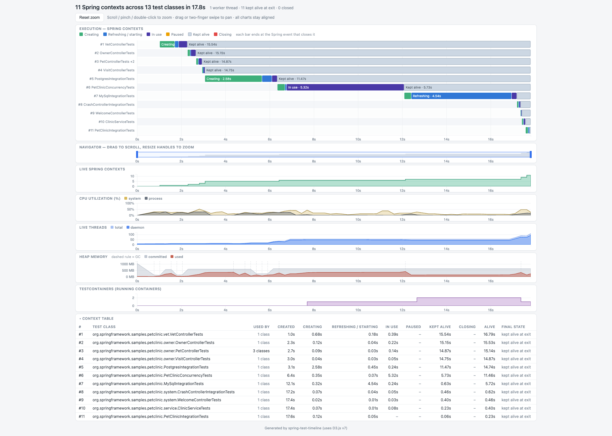

# spring-test-timeline
Spring Test and Context Timeline ⏱️

## How to use

Add Maven
```xml
<dependency>
    <groupId>com.github.seregamorph</groupId>
    <artifactId>spring-test-timeline</artifactId>
    <version>0.1-SNAPSHOT</version>
    <scope>test</scope>
</dependency>
```

or Gradle dependency to your project:
```kotlin
testRuntimeOnly("com.github.seregamorph:spring-test-timeline:0.1-SNAPSHOT")
```

and then run integration tests of the project.

## Sample report
Sample report for [spring-petclinic](https://github.com/spring-projects/spring-petclinic):



## Configuring

When the tests finish, `spring-test-timeline.html` and `spring-test-timeline.json` are written to the build output directory:
`target/` for Maven or `build/` for Gradle.

To write them to another directory, set the `springTestTimelineReportDir` system property on the test JVM. A relative
path resolves against the test JVM's working directory.

Maven (Surefire/Failsafe):
```xml
<plugin>
    <groupId>org.apache.maven.plugins</groupId>
    <artifactId>maven-failsafe-plugin</artifactId>
    <configuration>
        <systemPropertyVariables>
            <springTestTimelineReportDir>${project.build.directory}/timeline</springTestTimelineReportDir>
        </systemPropertyVariables>
    </configuration>
</plugin>
```

Or pass it on the command line: `./mvnw verify -DspringTestTimelineReportDir=/tmp/timeline`.

Gradle:
```kotlin
tasks.test {
    systemProperty("springTestTimelineReportDir", layout.buildDirectory.dir("timeline").get().asFile.absolutePath)
}
```
